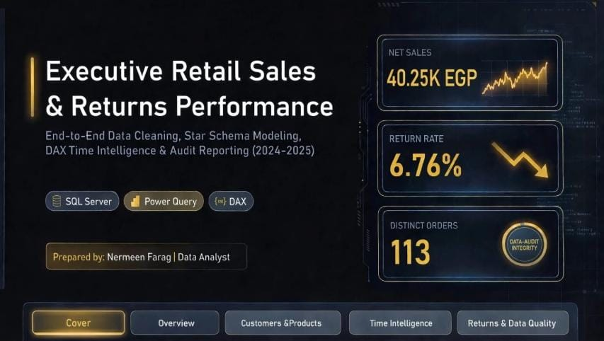
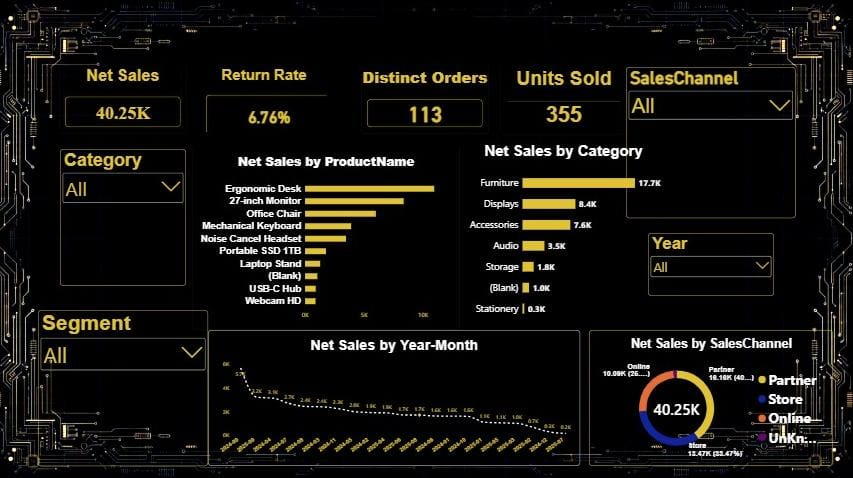
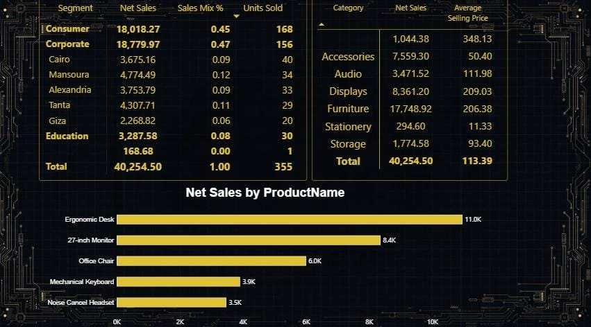
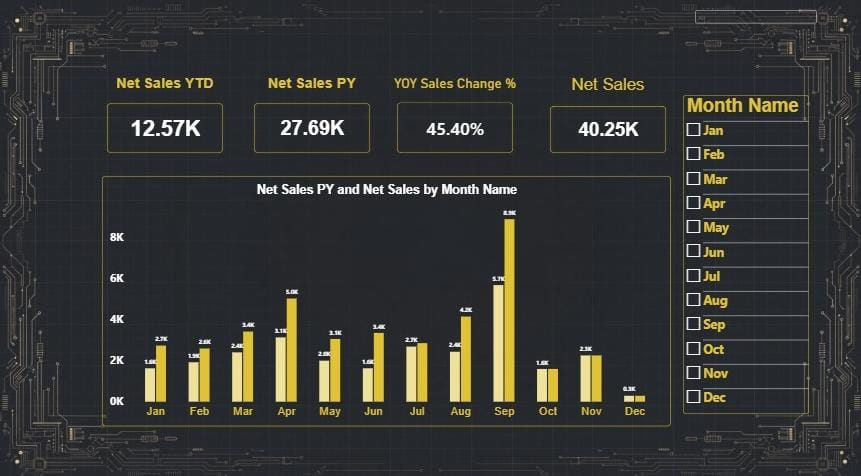
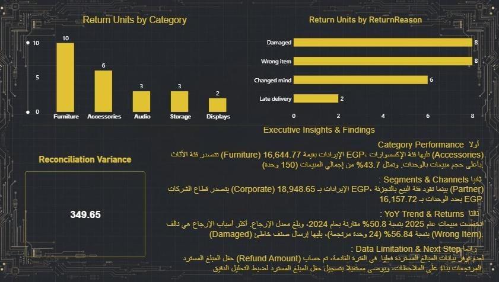

# 🛒 RETAIL SALES PERFORMANCE - Net Sales | Returns | Audit

### ✨ Cover Page

### 📊 Main Dashboard - Executive Overview

**KPIs:** Net Sales 40.25K EGP | Orders 113 | Units 355 | Return Rate 6.76% | Refund 1,249.80 EGP

---

### 📦 Category & Products Deep Dive

### ⏰ Time Intelligence - YOY Analysis

- YTD: 12.57K | PY: 27.69K | YOY %: 45.40%
- Top Month: September

### 🗺️ City & Region / Returns Audit

- Returns down 50.8% in 2025
- Top Reason: Wrong Item 56.84%
- Lowest Return: Furniture

---

### 🛠️ Tools Used
SQL Server (Cleaning) | Power Query | DAX | Power BI | Star Schema

### 💡 Key Insights
1. Furniture drives 43.7% of Net Sales
2. Corporate 47% & Partner channel lead
3. Returns improved 50.8% - Need refund automation

### 📹 Video Demo
> ارفعي الفيديو على يوتيوب Unlisted وحطي اللينك هنا

### 📁 Files
- `Retail Sales Dashboard.pbix` - Download to interact
- `Retail Presentation.pptx`

---
**Author:** Nermeen Elsayed Farg - Data Analyst
